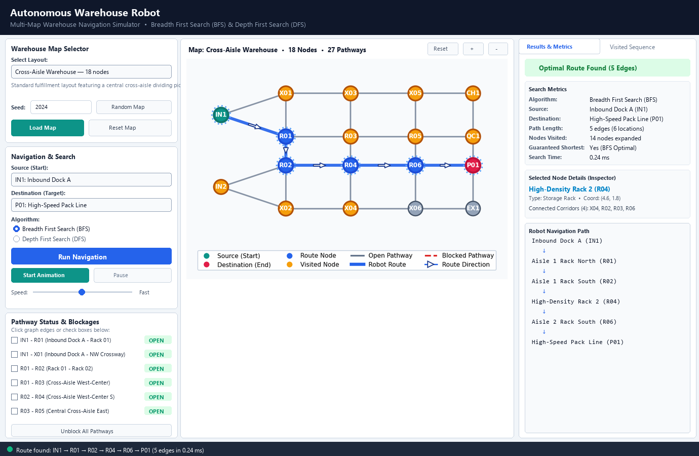

# Autonomous Warehouse Robot: Multi-Map Navigation Simulator

An educational and professional desktop application demonstrating how an autonomous mobile warehouse robot uses graph traversal and uninformed search algorithms—**Breadth First Search (BFS)** and **Depth First Search (DFS)**—to navigate through realistic multi-aisle warehouse layouts, avoid dynamic corridor blockages, and find optimal routes.

---

## 1. Project Overview

Modern automated distribution hubs rely on autonomous mobile robots (AMRs) to transport stock quickly and safely between receiving docks, storage racks, pick stations, and outbound shipping gates. This simulator provides an interactive desktop environment and visual testbed for warehouse logistics.

The simulator models the warehouse floor as an undirected graph and allows users to explore multiple warehouse scales—ranging from a 5-node educational starter map to a 50-node automated fulfillment center, as well as procedurally generated random layouts with seed reproducibility.

The project is built entirely with Python using **Tkinter** for the native desktop GUI, **NetworkX** for graph topology, and **Matplotlib** for interactive visualization.

---

## 2. Problem Statement

In an automated warehouse, a robot stationed at a source location (e.g., Inbound Receiving) must navigate to a target destination (e.g., Packing Station, Battery Charging Bay, or Dispatch Gate).

Key requirements:
1. **Valid Pathway Navigation**: Traversal through multi-aisle corridors, cross-aisles, and intersection junctions.
2. **Path Optimality**: Guaranteed shortest route in edge hops to minimize robot transit time and battery drain.
3. **Dynamic Obstacle Avoidance**: Re-routing around blocked corridors caused by pallet spills, maintenance, or robot congestion.
4. **Algorithmic Transparency**: Exposing internal search states (frontier queue/stack sizes, node exploration order, and predecessor parent maps).
5. **Multi-Scale Scalability**: Handling maps from compact 5-node layouts to 60-node megahubs with clean, non-overlapping visualization.

---

## 3. Predefined & Procedural Warehouse Maps

The simulator features a built-in map registry supporting multiple warehouse scales and topologies:

| Map Name | Node Count | Description | Primary Facilities |
| :--- | :---: | :--- | :--- |
| **Starter Map** | 5 nodes | Baseline educational map connecting Storage to Packing and Exit. | Storage, Rack A/B, Packing, Exit |
| **Compact Warehouse** | 12 nodes | Dual-aisle small facility with inbound receiving, racks, charging dock, and packing line. | Inbound Storage, Racks A1/B1, Crossways, Charging, Packing, Exits |
| **Cross-Aisle Warehouse** | 18 nodes | Standard fulfillment center with a dedicated central cross-aisle dividing picking aisles. | Inbound Docks, Racks R01–R06, Crossways X01–X06, Charging, QC, Packing, Dispatch |
| **Medium Warehouse** | 28 nodes | 7×4 multi-corridor logistics facility with 4 rack zones, perimeter highways, and dual dispatch. | Inbound Docks, Storage Racks M00–M63, Arterial Crossways, Charging, Packing, Exits |
| **Large Warehouse** | 50 nodes | 10×5 automated fulfillment megahub with 10 aisles, 3 crossways, and multiple work cells. | Inbound Gates, Racks N00–N94, Highway Intersections, Charging Hub, Packing, Exits |
| **Random Warehouse** | 8–60 nodes | Procedural, guaranteed-connected layout generated from a user-specified or randomized seed. | Procedurally placed Storage, Racks, Crossways, Charging, Packing, and Dispatch Docks |

### Procedural Random Map Generator (`map_generator.py`)
- **Configurable Scale**: Generates between 8 and 60 nodes structured along realistic warehouse aisles.
- **Seed Reproducibility**: Entering the same integer or text seed reproduces the exact same node placement, facility types, and corridor connections.
- **Guaranteed Connectivity**: Procedural graphs are verified to be fully connected without self-loops or duplicate edges.
- **Equal Cost Edges**: All pathways maintain unit cost, ensuring BFS remains mathematically optimal for shortest-path demonstrations.
- **Sensible Endpoints**: Automatically sets default source (Inbound Storage) and destination (Packing / Dispatch).

---

## 4. Application Architecture & 3-Area Layout

The user interface is structured into three clean, dedicated functional panels:



### Left Panel: Map Selection & Controls
- **Map Selector**: Dropdown to switch between Starter, Compact, Cross-Aisle, Medium, Large, and Random layouts.
- **Seed Controls**: Entry field for random seed with **Random Map** and **Reset Map** controls.
- **Endpoint Selection**: Dropdowns for arbitrary source and destination nodes across any loaded map.
- **Algorithm Selection**: Breadth First Search (BFS) and Depth First Search (DFS).
- **Execution Controls**: Primary **Run Navigation** button, **Start Animation**, **Pause/Resume**, and speed slider.
- **Scrollable Pathway List**: Complete list of corridors with checkboxes and instant `OPEN`/`BLOCKED` badges, plus **Unblock All**.

### Center Panel: Interactive Warehouse Canvas
- **Top Toolbar**: Displays current map name, node count, edge count, plus **Reset View**, **Zoom In (+)**, and **Zoom Out (-)** controls.
- **Dynamic Scaling Visualizer**: Automatically computes map bounding boxes, adapts node radii and font sizes, and draws navigation arrows along the robot path.
- **Edge Click-to-Block**: Clicking any corridor line on the canvas toggles its blocked/open status directly.
- **Node Click-to-Inspect**: Clicking any node highlights it on the canvas and loads full metadata into the Inspector card.
- **Visual Legend**: Clear guide explaining node roles (Source, Destination, Route, Visited) and pathway styles (Open, Route, Blocked).

### Right Panel: Results & Inspector
- **Search Metrics Card**: Displays status badge, algorithm used, path length (edges and locations), nodes visited, search time (in milliseconds), and guaranteed shortest indicator.
- **Selected Node Inspector**: Shows full details for the inspected node (Name, Facility Type, Coordinates $(x, y)$, and Connected Corridors).
- **Robot Navigation Path**: Multi-line arrow trajectory (`Storage Area ↓ Rack A ↓ Packing Station`).
- **Visited Sequence Tab**: Scrollable table showing the exact chronological expansion sequence with step numbers, location labels, facility types, and final path status.
- **AI Theory Guide Tab**: In-depth educational reference explaining graph traversal fundamentals.

---

## 5. AI Search Algorithms

### Breadth First Search (BFS)
- **Frontier Structure**: First-In, First-Out (FIFO) queue implemented with `collections.deque`.
- **Exploration Strategy**: Radial layer-by-layer expansion ($d = 0, 1, 2, \dots$) from the source location.
- **Optimality**: **Guaranteed optimal** in unweighted graphs. When BFS first pops the destination node, it is mathematically proven that no path with fewer edges exists.
- **Time Complexity**: $\mathcal{O}(V + E)$, where $V$ is warehouse locations and $E$ is navigable pathways.
- **Space Complexity**: $\mathcal{O}(V)$ for storing the queue and visited set.

### Depth First Search (DFS)
- **Frontier Structure**: Last-In, First-Out (LIFO) explicit stack.
- **Exploration Strategy**: Dives down a single pathway branch as deeply as possible before backtracking.
- **Optimality**: **Not guaranteed**. DFS frequently discovers long, winding routes because it commits to the first branch explored rather than expanding radially.
- **Time Complexity**: $\mathcal{O}(V + E)$.
- **Space Complexity**: $\mathcal{O}(V)$ for the stack and visited set.

### BFS vs. DFS Comparison Table
| Metric / Property | Breadth First Search (BFS) | Depth First Search (DFS) |
| :--- | :--- | :--- |
| **Frontier Data Structure** | `collections.deque` (FIFO Queue) | List / Stack (LIFO) |
| **Path Optimality (Uniform Cost)** | **Guaranteed Shortest** | Not Guaranteed |
| **Exploration Pattern** | Radial, layer-by-layer | Deep branch plunge first |
| **Detour Handling** | Finds the shortest detour | May find circuitous detour |
| **Warehouse Applicability** | **Recommended for robot navigation** | Educational contrast |

---

## 6. Presentation Guide: Exploration Order vs. Solution Path

When presenting or demonstrating this project, be sure to highlight a critical distinction in AI graph search:

### The Distinction
- **Final Robot Navigation Path** (e.g. `IN1 → R01 → R02 → R04 → R06 → P01`):
  - Represents the **physical trajectory** the robot follows across warehouse aisles.
  - Reconstructed by tracing backward along predecessor pointers from the destination to the source.
- **Chronological Visited / Exploration Sequence**:
  - Represents the **algorithmic search frontier** as nodes are dequeued from the queue/stack.
  - Demonstrates the true search overhead of uninformed exploration before locating the goal.

> **Key Presentation Insight**: Showing both the physical route and the search sequence illustrates how BFS evaluates all nodes at depth $k$ before depth $k+1$, confirming that the algorithm is executing authentic graph traversal rather than hardcoded heuristics.

---

## 7. Dynamic Pathway Blocking & Obstacle Detours

- **Dynamic Avoidance**: Corridors can be blocked via sidebar checkboxes or by clicking directly on the canvas edge.
- **Graph Immutability**: Searches never alter the underlying graph topology. Blocked edges are passed as a canonical set and ignored during neighbor expansion.
- **Automatic Detour Recalculation**: When a pathway along the current route is blocked, running navigation immediately finds the next shortest available detour.
- **No-Route Safety**: If all paths to a destination are severed, the application halts cleanly, displaying:
  ```
  No route available between the selected locations. Check if pathways are blocked.
  ```

---

## 8. Installation Instructions

### Prerequisites
- Python 3.10 or higher (Python 3.11+ recommended)
- `pip` package manager

### 1. Navigate to Project Directory
```bash
cd Pugazh-Project-FOAI
```

### 2. Set Up a Virtual Environment (Recommended)
```bash
# Windows
python -m venv venv
.\venv\Scripts\activate

# macOS / Linux
python3 -m venv venv
source venv/bin/activate
```

### 3. Install Dependencies
```bash
pip install -r requirements.txt
```

> **Note for Linux Users**: `tkinter` is distributed as part of standard Python on Windows and macOS. On Linux (Ubuntu/Debian), install the system package:
> ```bash
> sudo apt-get update && sudo apt-get install python3-tk
> ```

---

## 9. How to Run the Application

Launch the desktop simulator:
```bash
python app.py
```

---

## 10. Automated Testing Suite

The project includes **34 automated unit and GUI integration tests** verifying algorithm correctness, map scalability, and interface responsiveness.

### Running All Tests
```bash
python -m unittest discover tests
```

### Test Breakdown
1. **Algorithm Correctness (`tests/test_algorithms.py` — 12 tests)**:
   - BFS optimality and shortest path verification.
   - DFS path validity and divergence from BFS.
   - Edge cases: source equals destination, invalid nodes, disconnected partitions.
   - Obstacle avoidance and deterministic detour routing.
   - Graph immutability verification.

2. **Map Management & Procedural Generator (`tests/test_map_generation.py` — 11 tests)**:
   - Verification that all 5 predefined maps register and load into NetworkX graphs.
   - Node count constraints across map scales.
   - Graph connectivity guarantees across seeds.
   - Zero self-loops and zero duplicate edges.
   - Seed reproducibility (identical seed $\rightarrow$ identical map; different seed $\rightarrow$ different map).
   - BFS and DFS route discovery across all maps.
   - Blockage detour calculation on multi-corridor maps.

3. **Automated GUI Testing (`tests/test_gui.py` — 11 tests)**:
   - Widget creation, initial combobox values, and window titles.
   - Execution of BFS and DFS navigation through GUI handlers.
   - Switching maps in the GUI and rebuilding endpoint dropdowns.
   - Procedural map generation with seed via GUI.
   - Pathway checkbox toggle synchronization with graph model.
   - Direct canvas mouse-click edge toggling.
   - Direct canvas node click and inspector card population.
   - Dynamic UI responses for disconnected graphs ("No Route Available").
   - Result clearing, warehouse reset, and animation state transitions.

---

## 11. Code Structure

```
Pugazh-Project-FOAI/
│
├── app.py                     # Main Tkinter application (3-area layout, inspector, animation)
├── algorithms.py              # BFS, DFS, SearchResult, SearchTraceStep, and timing
├── warehouse_graph.py         # NetworkX warehouse graph model, coordinates & blockage manager
├── map_manager.py             # WarehouseMap registry & predefined maps (Starter to Large)
├── map_generator.py           # Procedural random warehouse generator with seed reproducibility
├── visualization.py           # Matplotlib visualizer with dynamic scaling & zoom/pan controls
├── requirements.txt           # Project dependencies (networkx, matplotlib)
├── screenshot_gui.png         # High-resolution screenshot of the multi-map interface
├── README.md                  # Comprehensive AI documentation and user guide
│
└── tests/
    ├── __init__.py            # Test package initializer
    ├── test_algorithms.py    # 12 unit tests for search algorithms
    ├── test_map_generation.py# 11 unit tests for map scaling & procedural generator
    └── test_gui.py           # 11 automated integration tests for Tkinter GUI
```

---

## 12. Learning Outcomes

1. **Applied Graph Modeling**: Translating physical logistics environments into structured adjacency graphs with node attributes.
2. **Uninformed Search Dynamics**: Observing how FIFO queues vs. LIFO stacks fundamentally dictate traversal patterns and route optimality.
3. **Optimality Proofs**: Experiencing why BFS is mathematically optimal for uniform-cost navigation while DFS explores branches blindly.
4. **Dynamic Detour Re-planning**: Understanding how autonomous robots detect blocked corridors and re-plan routes in real time.
5. **Procedural World Generation**: Designing seed-reproducible grid-based procedural environments with guaranteed graph connectivity.
6. **Production Desktop Engineering**: Embedding Matplotlib figures into Tkinter with high-DPI scaling, interactive event picking, and non-blocking animation frames.

---

## 13. Future Improvements

1. **Informed Search (A* Search & Dijkstra)**: Introduce variable aisle lengths (meters) and Euclidean / Manhattan distance heuristics.
2. **Multi-Robot Collision Avoidance (MAPF)**: Simulate multiple robots operating concurrently with Time-Space reservation grids.
3. **Pick-List Optimization (TSP / VRP)**: Support multi-stop order picking from multiple racks before reaching the packing station.
4. **Interactive Drag-and-Drop Floor Builder**: Allow users to add custom racks, charging pads, and walls directly on the visualizer canvas.
