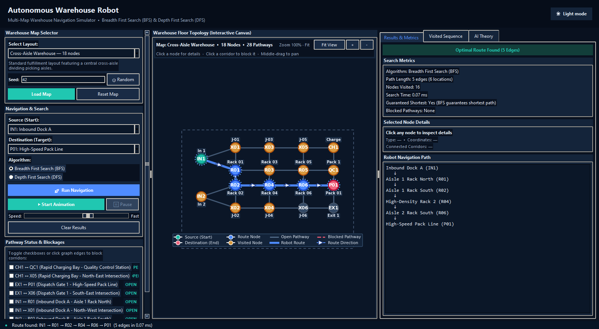

# Autonomous Warehouse Robot

An interactive desktop simulator that demonstrates how a warehouse robot plans routes through a graph of aisles, racks, work cells, and delivery points.

The application lets a user choose a warehouse layout, select a start and destination, run **Breadth First Search (BFS)** or **Depth First Search (DFS)**, inspect the search process, and reroute around blocked pathways.



## What the project demonstrates

- Warehouse navigation represented as an undirected NetworkX graph.
- BFS shortest-path navigation for equal-cost pathways.
- DFS traversal for algorithm comparison.
- Multiple predefined warehouse layouts from 5 to 50 nodes.
- Seeded random warehouse generation from 8 to 60 nodes.
- Interactive pathway blockages and automatic detours.
- Search animation with visited-node and route visualization.
- Named node metadata, visited order, route metrics, and AI theory notes.
- Dark glass interface with light mode support.

## Maps included

| Map | Size | Purpose |
| --- | ---: | --- |
| Starter Map | 5 nodes | Small graph for learning the basic workflow. |
| Compact Warehouse | 12 nodes | Small multi-aisle warehouse. |
| Cross-Aisle Warehouse | 18 nodes | Central cross-aisle layout with work cells. |
| Medium Warehouse | 28 nodes | Larger multi-corridor logistics layout. |
| Large Warehouse | 50 nodes | Fulfillment-center style warehouse with multiple zones. |
| Random Warehouse | 8–60 nodes | Seeded procedural layout for repeatable experiments. |

## How to use the simulator

1. Start the application and choose a map from **Select Layout**.
2. For a random map, enter a seed or click **Random**, then load the map.
3. Select the robot’s **Source** and **Destination**.
4. Choose **BFS** or **DFS**.
5. Click **Run Navigation** to calculate the route and display the metrics.
6. Click **Start Animation** to watch the search expand step by step. The animation can be paused and resumed.
7. Block a pathway using the checkbox list or by clicking a corridor on the graph.
8. Run navigation again to see the robot select an available detour.

### Map controls

- Click a node to inspect its name, type, coordinates, and connected corridors.
- Use the mouse wheel or `+` and `−` buttons to zoom.
- Hold the middle mouse button and drag to pan the map.
- Use **Fit View** to restore the complete map.
- The dashed viewport boundary shows the safe visible area at the zoom limit.
- Use the header button to switch between dark mode and light mode.

## BFS and DFS

### Breadth First Search

BFS explores the graph level by level using a FIFO queue. Because every pathway has equal cost in this project, BFS guarantees the route with the fewest edges.

### Depth First Search

DFS explores one branch deeply using a stack before backtracking. It finds a valid route when one exists, but the route may contain more edges than the BFS route.

| Property | BFS | DFS |
| --- | --- | --- |
| Frontier | FIFO queue | LIFO stack |
| Shortest route guarantee | Yes, for equal-cost edges | No |
| Exploration style | Level by level | Deep branch first |
| Best use in this project | Robot route planning | Search behavior comparison |

## Blocked pathways and rerouting

Blocked corridors are maintained separately from the graph structure. During a search, blocked edges are ignored while the original warehouse topology remains unchanged.

If the active route is blocked, run the search again. The application recalculates the route, updates the blocked-pathway metric, and draws the new robot path. If every route is closed, the result panel reports that no route is available.

## Technology

- **Python** for the application and search algorithms.
- **Tkinter** for the desktop interface.
- **NetworkX** for graph modeling.
- **Matplotlib** for the interactive warehouse canvas.
- **unittest** for algorithm, map, and GUI integration tests.

## Installation

Requirements: Python 3.10 or newer. Python 3.11+ is recommended.

```bash
git clone https://github.com/rohanv2007/autonomous-warehouse-robot.git
cd autonomous-warehouse-robot
python -m venv venv
```

Activate the environment:

```powershell
# Windows PowerShell
.\venv\Scripts\Activate.ps1
```

```bash
# macOS or Linux
source venv/bin/activate
```

Install the Python dependencies:

```bash
pip install -r requirements.txt
```

On Debian or Ubuntu, install Tkinter if it is not already available:

```bash
sudo apt-get install python3-tk
```

## Run

```bash
python app.py
```

## Windows executable

The project includes `launcher.py`, which checks the packaged runtime for Tkinter, NetworkX, and Matplotlib before opening the simulator. A standalone build can be launched by double-clicking:

```text
dist/AutonomousWarehouseRobot.exe
```

The executable bundles Python and the project dependencies, so the client does not need to install Python or run a terminal command. To rebuild it on Windows:

```powershell
py -3.10 -m pip install -r requirements.txt
py -3.10 -m pip install pyinstaller
pyinstaller --noconfirm --clean --onefile --windowed --name AutonomousWarehouseRobot --hidden-import=matplotlib.backends.backend_tkagg launcher.py
```

## Test

Run the complete test suite from the project directory:

```bash
python -m unittest discover -s tests -v
```

The suite covers:

- BFS and DFS correctness.
- Shortest-path guarantees.
- Blocked-edge avoidance and no-route handling.
- Predefined and random map connectivity.
- Seed reproducibility.
- Map switching, animation, node inspection, and GUI controls.

## Project structure

```text
autonomous-warehouse-robot/
├── app.py                    # Tkinter application and interaction logic
├── algorithms.py             # BFS, DFS, search traces, and result metrics
├── warehouse_graph.py        # Graph model, metadata, and blocked edges
├── map_manager.py            # Predefined map registry
├── map_generator.py          # Seeded random warehouse generation
├── visualization.py          # Matplotlib graph rendering and map controls
├── launcher.py                # Runtime check and packaged-app entry point
├── requirements.txt          # Python dependencies
├── README_preview.png        # Current dark-mode interface preview
├── build_video.py            # Optional local demo compositor
└── tests/                    # Automated algorithm, map, and GUI tests
```

## Learning outcomes

This project demonstrates graph modeling, uninformed search, shortest-path planning, state-space exploration, dynamic obstacle handling, and the role of intelligent agents in warehouse automation.
